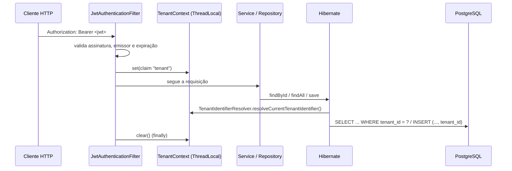

# Nexus Loan

API REST **SaaS B2B multi-tenant** para gestão de empréstimos. Cada organização (tenant) cadastra seus clientes e solicita empréstimos, que são aprovados ou reprovados automaticamente. O isolamento entre tenants é garantido pela camada de persistência, não pelo código de cada endpoint.

[](../../actions/workflows/ci.yml)

## Sumário

- [Stack](#stack)
- [Funcionalidades](#funcionalidades)
- [Como rodar](#como-rodar)
- [Endpoints](#endpoints)
- [Como funciona o multi-tenant](#como-funciona-o-multi-tenant)
- [Segurança](#segurança)
- [Regra de aprovação](#regra-de-aprovação)
- [Decisões técnicas](#decisões-técnicas)
- [Estrutura do projeto](#estrutura-do-projeto)
- [Testes e CI](#testes-e-ci)
- [Próximos passos](#próximos-passos)

## Stack

| Camada          | Tecnologia                                                |
|-----------------|-----------------------------------------------------------|
| Linguagem       | Java 21                                                   |
| Framework       | Spring Boot 3.5 (Web, Data JPA, Security, Validation)      |
| Persistência    | PostgreSQL 16, Hibernate 6 (`@TenantId`), Flyway          |
| Autenticação    | JWT (HS256, jjwt 0.12)                                    |
| Observabilidade | Spring Boot Actuator                                      |
| Testes          | JUnit 5, Mockito, MockMvc, Testcontainers                 |
| Entrega         | Docker (multi-stage), Docker Compose, GitHub Actions      |

## Funcionalidades

- **Onboarding self-service**: cria a organização (tenant) e o primeiro usuário `ADMIN` em uma única transação.
- **Login com JWT**: o token carrega `tenant`, `role` e `email` do usuário.
- **Usuários**: um `ADMIN` cria usuários `ADMIN` ou `USER` dentro do próprio tenant.
- **Clientes**: cadastro com validação de CPF/CNPJ (dígitos verificadores), busca por ID e listagem paginada.
- **Empréstimos**: solicitação com aprovação ou reprovação automática e motivo, busca por ID, listagem por cliente e por tenant.
- **Observabilidade**: `/actuator/health` (com probes de liveness e readiness), `/actuator/info` (versão e build) e `/actuator/metrics`.
- **Erros padronizados** no formato RFC 7807 (`application/problem+json`).

## Como rodar

### Pré-requisitos

- Docker e Docker Compose
- Para rodar fora do Docker: Java 21 e Maven 3.9+

### Com Docker Compose (recomendado)

```bash
cp .env.example .env
# Edite o .env:
#   POSTGRES_PASSWORD=<senha forte>
#   JWT_SECRET=<saída de: openssl rand -base64 48>

docker compose up --build
```

A API sobe em `http://localhost:8080`. O Compose não sobe se alguma variável obrigatória estiver vazia.

### Localmente (perfil `dev`)

```bash
# Postgres via Compose
docker compose up -d postgres

export DB_USERNAME=nexusloan
export DB_PASSWORD=<a mesma senha do .env>
export JWT_SECRET=$(openssl rand -base64 48)

mvn spring-boot:run -Dspring-boot.run.profiles=dev
```

O perfil `dev` usa `jdbc:postgresql://localhost:5432/nexusloan` como URL padrão, exibe o SQL gerado e mostra os detalhes completos do health.

### Configuração

Toda configuração sensível vem de variáveis de ambiente. Nenhum segredo tem valor padrão.

| Variável                     | Obrigatória | Padrão       | Descrição                                       |
|------------------------------|:-----------:|--------------|-------------------------------------------------|
| `DB_URL`                     | sim¹        | —            | URL JDBC do PostgreSQL                          |
| `DB_USERNAME`                | sim         | —            | Usuário do banco                                |
| `DB_PASSWORD`                | sim         | —            | Senha do banco                                  |
| `JWT_SECRET`                 | sim         | —            | Chave HMAC (mínimo 32 bytes; a API não sobe sem) |
| `JWT_EXPIRATION`             | não         | `PT1H`       | Validade do token (ISO-8601)                    |
| `JWT_ISSUER`                 | não         | `nexus-loan` | Claim `iss`                                     |
| `LOAN_MAX_INCOME_MULTIPLIER` | não         | `10`         | Multiplicador da regra de aprovação             |
| `SERVER_PORT`                | não         | `8080`       | Porta HTTP                                      |

¹ No perfil `dev`, o padrão é `localhost:5432/nexusloan`.

### Demonstração com Postman

Importe `postman/NexusLoan.postman_collection.json` e execute as pastas em ordem:

1. **Onboarding & Auth**: cria um tenant com slug, e-mail e senha aleatórios, faz login e guarda o token.
2. **Clientes**: cria um cliente (com CPF válido gerado por script) e guarda o `clienteId`.
3. **Empréstimos**: uma solicitação aprovada (30.000 com renda de 5.000) e uma reprovada (50.000,01).
4. **Actuator**: health, info e metrics.

Para demonstrar o isolamento, limpe as variáveis `tenantSlug`, `adminEmail`, `adminPassword` e `token`, rode a pasta 1 de novo (cria um segundo tenant) e chame **Buscar cliente por ID**. A resposta é `404`, porque aquele cliente pertence ao outro tenant.

### Exemplo com curl

```bash
# 1. Onboarding
curl -X POST localhost:8080/api/tenants -H 'Content-Type: application/json' -d '{
  "tenantName": "Acme Crédito", "tenantSlug": "acme",
  "adminName": "Ana", "adminEmail": "ana@acme.com", "adminPassword": "<senha>"
}'

# 2. Login
TOKEN=$(curl -s -X POST localhost:8080/api/auth/login -H 'Content-Type: application/json' \
  -d '{"tenant":"acme","email":"ana@acme.com","password":"<senha>"}' | jq -r .accessToken)

# 3. Cliente
curl -X POST localhost:8080/api/clientes -H "Authorization: Bearer $TOKEN" \
  -H 'Content-Type: application/json' \
  -d '{"name":"Maria Silva","document":"529.982.247-25","email":"maria@exemplo.com","monthlyIncome":5000}'

# 4. Empréstimo
curl -X POST localhost:8080/api/emprestimos -H "Authorization: Bearer $TOKEN" \
  -H 'Content-Type: application/json' -d '{"clienteId":"<id>","amount":40000}'
```

Resposta do passo 4:

```json
{
  "id": "3480e846-...",
  "clienteId": "b44d4052-...",
  "amount": 40000.00,
  "status": "APPROVED",
  "reason": "Aprovado: valor solicitado de R$ 40.000,00 está dentro do limite de R$ 50.000,00 (10x a renda mensal de R$ 5.000,00).",
  "createdAt": "2026-10-22T22:36:37.172Z",
  "updatedAt": "2026-10-22T22:36:37.172Z"
}
```

## Endpoints

| Método | Rota                                   | Acesso        | Descrição                                   |
|--------|----------------------------------------|---------------|---------------------------------------------|
| POST   | `/api/tenants`                         | público       | Cria um tenant e o seu ADMIN                |
| POST   | `/api/auth/login`                      | público       | Autentica (`tenant` + `email` + `password`) |
| POST   | `/api/users`                           | ADMIN         | Cria usuário no tenant                      |
| GET    | `/api/users`                           | ADMIN         | Lista usuários do tenant                    |
| POST   | `/api/clientes`                        | autenticado   | Cadastra cliente                            |
| GET    | `/api/clientes`                        | autenticado   | Lista clientes do tenant                    |
| GET    | `/api/clientes/{id}`                   | autenticado   | Busca cliente                               |
| POST   | `/api/emprestimos`                     | autenticado   | Solicita empréstimo                         |
| GET    | `/api/emprestimos`                     | autenticado   | Lista empréstimos do tenant                 |
| GET    | `/api/emprestimos/{id}`                | autenticado   | Busca empréstimo                            |
| GET    | `/api/emprestimos/cliente/{clienteId}` | autenticado   | Lista empréstimos de um cliente             |
| GET    | `/actuator/health`, `/actuator/info`   | público       | Saúde e informações da aplicação            |
| GET    | `/actuator/metrics`                    | ADMIN         | Métricas (Micrometer)                       |

As listagens são paginadas: `?page=0&size=20&sort=createdAt,desc` (padrão `size=20`, máximo `100`).

Formato de erro (RFC 7807):

```json
{
  "type": "about:blank",
  "title": "Dados inválidos",
  "status": 400,
  "detail": "Um ou mais campos são inválidos",
  "instance": "/api/clientes",
  "errors": [{ "field": "document", "message": "deve ser um CPF ou CNPJ válido" }]
}
```

| Status | Quando                                                                 |
|--------|------------------------------------------------------------------------|
| 400    | Validação, JSON malformado, UUID ou ordenação inválidos                |
| 401    | Token ausente, inválido ou expirado; credenciais inválidas no login    |
| 403    | Role insuficiente (ex.: `USER` em `/api/users`)                        |
| 404    | Recurso inexistente **ou pertencente a outro tenant**                  |
| 409    | Slug, e-mail ou documento duplicado                                    |

## Como funciona o multi-tenant

A estratégia é **discriminator column**: um único schema, e toda tabela de negócio tem uma coluna `tenant_id`.



As peças:

1. **Origem do tenant**: o tenant vem *somente* da claim `tenant` do JWT assinado. Nada no header, no path ou no body define o tenant. O cliente não tem como escolher outro.
2. **`TenantContext`** (`tenant/TenantContext.java`): `ThreadLocal<UUID>` preenchido pelo filtro e sempre limpo no `finally`, para que não vaze entre requisições na mesma thread do pool.
3. **`TenantIdentifierResolver`** (`tenant/TenantIdentifierResolver.java`): implementa o `CurrentTenantIdentifierResolver` do Hibernate e é registrado via `HibernatePropertiesCustomizer`.
4. **`@TenantId`** (`entity/TenantScopedEntity.java`): recurso nativo do Hibernate 6 para discriminator. Para toda entidade que herda de `TenantScopedEntity` (`User`, `Cliente`, `Emprestimo`), o Hibernate:
   - adiciona `tenant_id = ?` em **todas** as consultas, incluindo `findById`, queries derivadas, JPQL e paginação;
   - preenche `tenant_id` automaticamente no INSERT (o código nunca atribui o campo);
   - recusa carregar uma entidade de outro tenant.

#### Por que não precisa de `WHERE tenant_id` nos repositories

Com `@Filter` ou `Specification`, cada query nova tem que se lembrar de aplicar o filtro. O `@Filter`, em especial, não cobre `em.find()`. Com `@TenantId`, o filtro faz parte do mapeamento da entidade: não existe caminho no JPA que o ignore. Os repositories ficam limpos, como `ClienteRepository.existsByDocument(document)`.

#### Fail-closed

Sem tenant no contexto (rota pública ou token inválido), o resolver devolve um UUID sentinela (`00000000-...`) que não existe na tabela `tenant`. Consultas em entidades isoladas retornam vazio e inserts falham na FK. Ou seja, a ausência de tenant **bloqueia** o acesso em vez de liberá-lo.

#### Defesa em profundidade no banco

- Unicidade por tenant: `UNIQUE (tenant_id, email)` em usuários e `UNIQUE (tenant_id, document)` em clientes. O mesmo CPF pode existir em tenants diferentes.
- A FK composta `emprestimo (tenant_id, cliente_id) → cliente (tenant_id, id)` impede, no próprio banco, um empréstimo apontar para um cliente de outro tenant.

#### Fluxos sem JWT (login e onboarding)

- **Login**: `Tenant` não é entidade isolada, então a busca por slug funciona sem contexto. Depois, `TenantContext.callAs(tenantId, ...)` executa a busca do usuário *dentro* daquele tenant. Por isso o e-mail é único por tenant, não globalmente.
- **Onboarding**: o UUID do tenant é gerado pela aplicação e colocado no contexto **antes** de a transação abrir, porque o Hibernate lê o tenant ao abrir a sessão. Assim, tenant e ADMIN são gravados atomicamente na mesma transação. `Tenant` implementa `Persistable` para que o Spring Data faça `persist` (e não `merge`) mesmo com o id já preenchido.

#### Recurso de outro tenant responde 404, não 403

Responder 403 confirmaria que o ID existe. Com 404, não há como enumerar recursos de outros tenants.

## Segurança

- JWT HS256 stateless. A chave vem de `JWT_SECRET` e é validada na subida (mínimo 32 bytes).
- Senhas com BCrypt (`DelegatingPasswordEncoder`, hash com prefixo `{bcrypt}`, o que permite migrar de algoritmo no futuro).
- No login, quando o tenant ou o e-mail não existem, a senha é comparada contra um hash aleatório gerado na subida. O tempo de resposta fica igual e não revela quais e-mails estão cadastrados. A mensagem de erro também é sempre a mesma.
- Autorização por role com `@PreAuthorize` (`UserController`) e por rota (`/actuator/metrics` só para ADMIN).
- O `UserDetailsServiceAutoConfiguration` é excluído para que o Spring Boot não crie um usuário em memória com senha gerada.
- O filtro JWT roda apenas dentro da cadeia do Spring Security (o registro automático como filtro do servlet está desabilitado).
- O container roda como usuário não-root.

## Regra de aprovação

```
limite = monthlyIncome × LOAN_MAX_INCOME_MULTIPLIER   (padrão 10)
amount >  limite  →  REJECTED
amount <= limite  →  APPROVED
```

- A regra fica isolada em `LoanApprovalPolicy`. O multiplicador vem da configuração, então dá para mudar sem recompilar.
- O empréstimo nasce `PENDING`, e `Emprestimo.decide(...)` faz a transição. Ela só é permitida a partir de `PENDING`, o que já prepara o terreno para uma análise assíncrona (ver próximos passos).
- O `reason` registra os valores usados na decisão, formatados em reais (`R$ 50.000,00`).

## Decisões técnicas

| Decisão                                    | Motivo                                                                                  |
|--------------------------------------------|-----------------------------------------------------------------------------------------|
| Discriminator column com `@TenantId`       | Mais barato de operar que schema/database por tenant; filtro garantido pelo ORM          |
| Tenant como entidade + slug no login       | Modelo de "workspace" de SaaS; permite o mesmo e-mail em organizações diferentes        |
| UUID como chave primária                   | IDs não sequenciais não são enumeráveis e podem ser gerados fora do banco               |
| Flyway + `ddl-auto=validate`               | Schema versionado e revisável; o Hibernate só confere o mapeamento                      |
| `open-in-view: false`                      | Evita lazy loading fora da transação e queries ocultas na camada web                    |
| DTOs como `record`                         | Imutáveis; a entidade nunca é exposta                                                   |
| ProblemDetail (RFC 7807)                   | Contrato de erro padronizado, inclusive nos 401/403 gerados pelos filtros               |
| `BigDecimal` + `NUMERIC(15,2)`             | Precisão monetária; valores normalizados para 2 casas na entidade                       |
| Timestamps via `@PrePersist`/`@PreUpdate`  | Ficam disponíveis logo após o `save()`, antes do flush                                  |
| Paginação em todas as listagens            | Uma listagem sem limite não escala em multi-tenant                                      |
| Configuração 100% por ambiente             | Nenhum segredo no repositório; a aplicação não sobe sem as variáveis obrigatórias       |

## Estrutura do projeto

```
src/main/java/com/nexusloan
├── config       # SecurityConfig, propriedades tipadas (JWT, regra de empréstimo), TransactionTemplate
├── controller   # REST controllers (só DTOs entram e saem)
├── dto          # records de request/response + validação de CPF/CNPJ
├── entity       # BaseEntity, TenantScopedEntity (@TenantId), Tenant, User, Cliente, Emprestimo
├── enums        # Role, LoanStatus
├── exception    # GlobalExceptionHandler (RFC 7807) e exceções de domínio
├── repository   # Spring Data JPA, sem nenhuma referência explícita a tenant
├── security     # JwtService, JwtAuthenticationFilter, handlers de 401/403
├── service      # regras de negócio, LoanApprovalPolicy, onboarding, auth
└── tenant       # TenantContext (ThreadLocal) e TenantIdentifierResolver
src/main/resources
├── application.yml / application-dev.yml
└── db/migration # scripts Flyway
```

## Testes e CI

```bash
mvn verify          # unitários + integração (precisa de Docker para o Testcontainers)
```

| Teste                         | Tipo                          | Cobre                                                                                     |
|-------------------------------|-------------------------------|-------------------------------------------------------------------------------------------|
| `LoanApprovalPolicyTest`      | unitário                      | limite exato, acima do limite, renda zero, multiplicador configurável                     |
| `CpfCnpjValidatorTest`        | unitário                      | CPF/CNPJ com e sem máscara, dígitos inválidos, sequências repetidas                       |
| `EmprestimoServiceTest`       | unitário (Mockito)            | aplicação da decisão; cliente invisível no tenant não gera empréstimo                     |
| `MultiTenantIntegrationTest`  | integração (PostgreSQL real)  | fluxo completo, **isolamento entre tenants**, documento duplicado por tenant, 401/403, validação |

O teste de integração cria dois tenants via API e prova que o tenant B recebe `404` em `GET /clientes/{id}`, `GET /emprestimos/{id}` e `GET /emprestimos/cliente/{id}` do tenant A, vê listagens vazias e não consegue criar um empréstimo para um cliente de A.

O workflow `.github/workflows/ci.yml` roda `mvn verify` (Java 21, cache do Maven, relatórios do Surefire como artifact) e depois faz o build da imagem Docker.

## Próximos passos

**Produto**
- Ciclo de vida do empréstimo: parcelas, cronograma de pagamento, juros (Price/SAC), cancelamento.
- Análise de crédito assíncrona: o empréstimo nasce `PENDING` e um consumidor decide, consultando bureaus de crédito.
- Atualização e desativação de clientes; auditoria de quem decidiu o quê (Hibernate Envers ou event log).
- Planos e limites por tenant (quotas de clientes e de requisições).

**Arquitetura**
- **Mensageria** (Kafka ou RabbitMQ): publicar `EmprestimoSolicitado` / `EmprestimoDecidido` com Outbox Pattern para consistência entre banco e broker.
- **Microsserviços**: separar Identity (tenants, usuários, tokens), Clientes e Crédito, com o `tenant` propagado no JWT e nos headers das mensagens.
- **Isolamento mais forte** para tenants enterprise: schema ou database por tenant (o Hibernate suporta via `MultiTenantConnectionProvider`, reaproveitando o mesmo `TenantContext`), ou Row-Level Security no PostgreSQL como segunda barreira.
- Identity Provider externo (Keycloak/Auth0) com OAuth2/OIDC, refresh tokens e chave assimétrica (RS256 + JWKS).

**Operação**
- Rate limiting no login e no onboarding (Bucket4j ou API Gateway), além de verificação de e-mail no onboarding.
- Observabilidade completa: Micrometer + Prometheus/Grafana, tracing com OpenTelemetry, logs estruturados com `tenantId` no MDC.
- OpenAPI/Swagger para documentação interativa.
- Deploy: Kubernetes (aproveitando os probes de liveness/readiness já expostos), Terraform e pipeline de CD.
